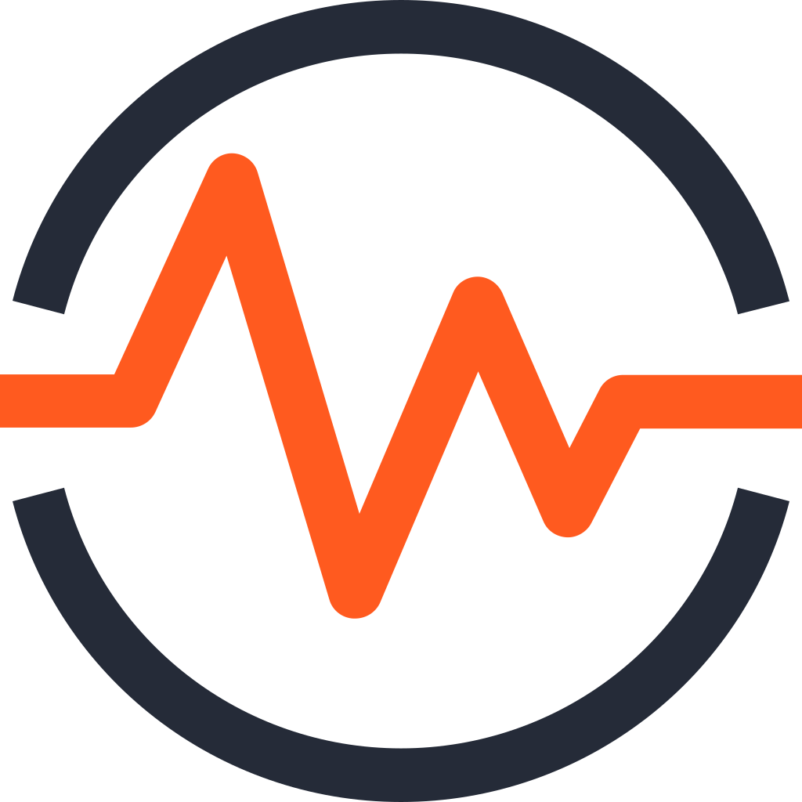
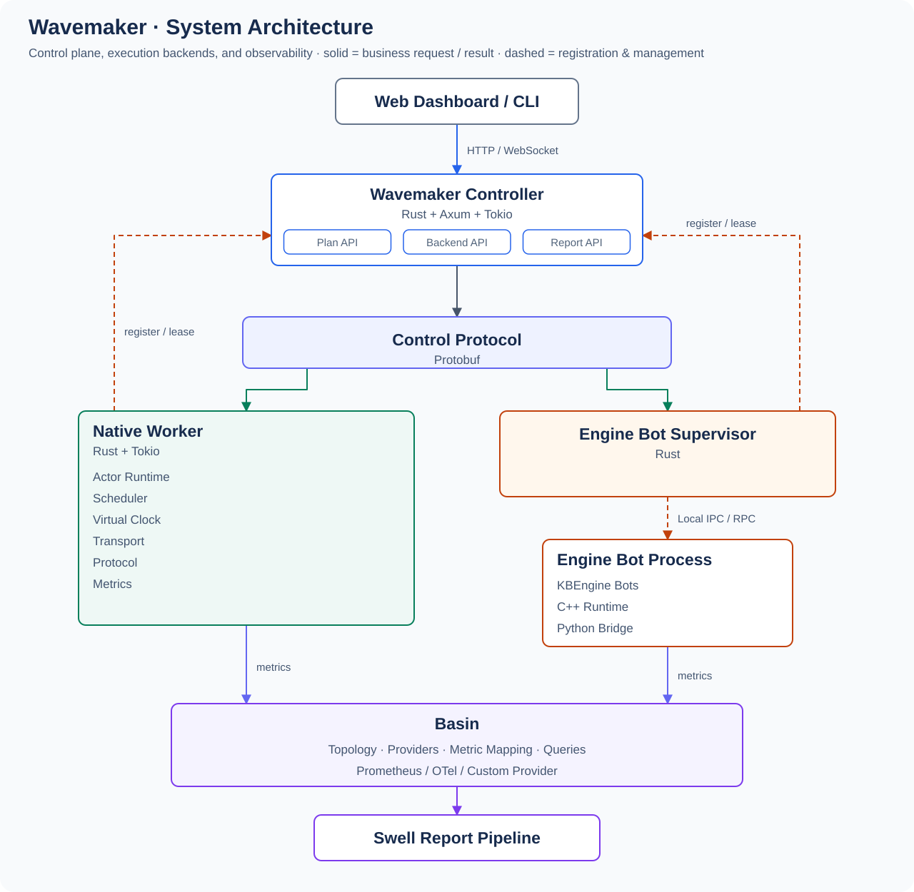

  

<h1 align="center">Wavemaker</h1>

A cross-engine game server load testing framework.

<a href="README.md">English</a> | <a href="README.zh.md">中文</a>

 

## About

Wavemaker generates, manages, and analyzes the load that large numbers of virtual clients apply to game servers. It works across game engines through a unified load model (Spectrum), deterministic plan data (ShardPlan), a pluggable execution backend interface (Native Runtime and engine bot backends), and a unified observability model (Basin for the server, Generator Observability for the load generators themselves).

It is not a plain bot scripting framework, nor a general-purpose distributed task queue.

## Documentation

The complete technical design and implementation plan is published at **https://cuihairu.github.io/wavemaker/**, in English and 简体中文. It covers the overall architecture, execution backend model, the KBEngine Bridge adapter, Spectrum semantics and deterministic plans, observability design, testing strategy, and the phased implementation roadmap.

## Status

Wavemaker is in the active-build stage. Phase 0 (semantics) and Phase 1 (protocol + minimal control plane) are implemented and tested; the phased roadmap (Phase 0–6) in the documentation defines what gets built and in what order.

An MCP server (`crates/wm-mcp`, stdio via the official rmcp SDK) exposes `list_runs`, `query_status`, `validate_spectrum`, `load_timeline` and `run_scenario` to AI agents; see [crates/wm-mcp/README.md](crates/wm-mcp/README.md).

## Daily Builds

Get the latest rolling build from the **Releases page** (the `nightly` release):

- **https://github.com/cuihairu/wavemaker/releases/tag/nightly**

A new build lands daily (05:17 CST). Choose your asset:

| Asset | Platform | Verify |
|---|---|---|
| `wavemaker-linux-x86_64` | Linux x86_64 | `./wavemaker-linux-x86_64 --version` |
| `wavemaker-linux-aarch64` | Linux ARM64 | `./wavemaker-linux-aarch64 --version` |

Each asset ships with a `.sha256` checksum; the latest build is always the only copy (older builds are replaced, never accumulated). Binaries are unsigned — SmartScreen/Gatekeeper may warn.

## License

Apache-2.0. See [LICENSE](LICENSE).
