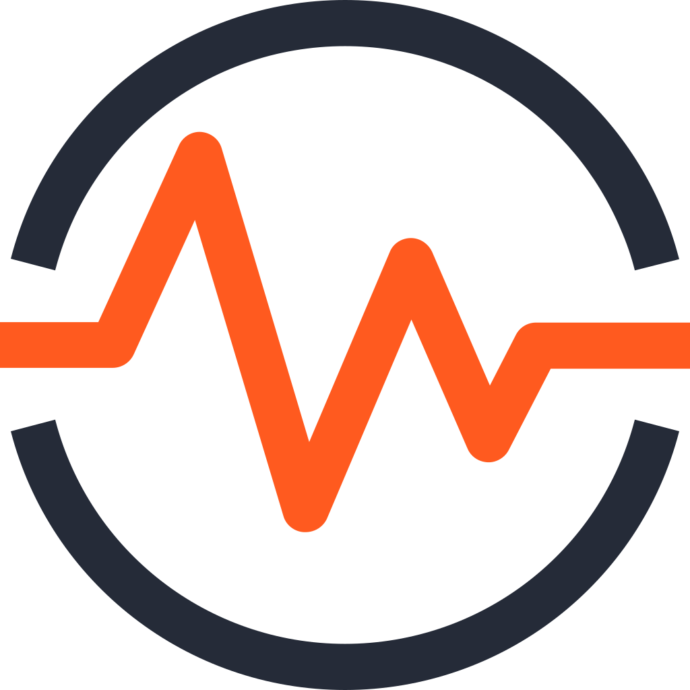
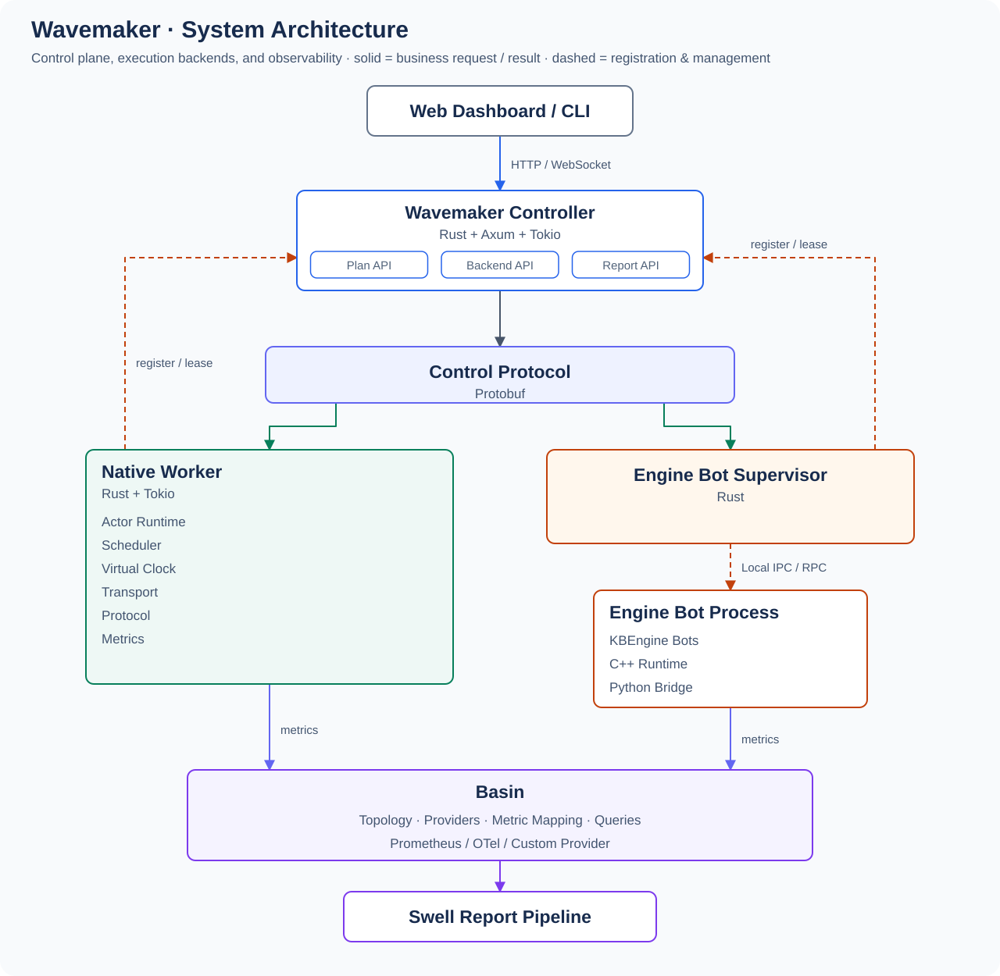

  

<h1 align="center">Wavemaker</h1>

跨引擎游戏服务器负载测试框架。

<a href="README.md">English</a> | <a href="README.zh.md">中文</a>

 

## 简介

Wavemaker 通过统一的负载模型（Spectrum）、确定性计划数据（ShardPlan）、可插拔的执行后端接口（Native Runtime 与引擎 Bot 后端）和统一的观测模型（面向服务端的 Basin、面向发生器自身的 Generator Observability），生成、管理并分析大量虚拟客户端对游戏服务端施加的负载，支持跨游戏引擎工作。

它不是单纯的 Bot 脚本框架，也不是通用分布式任务队列。

## 文档

完整技术设计与实施计划发布在 **https://cuihairu.github.io/wavemaker/**，提供英文与简体中文两个版本。内容覆盖总体架构、执行后端模型、KBEngine Bridge 适配器、Spectrum 语义与确定性计划、观测设计、测试策略与分阶段实施计划。

## 状态

Wavemaker 处于持续构建阶段。Phase 0（语义）与 Phase 1（协议 + 最小控制面）已实现并有测试覆盖；文档中的分阶段路线图（Phase 0–6）定义了实现顺序。

## 每日构建

最新滚动构建请到 **Releases 页**（`nightly` 发布）获取：

- **https://github.com/cuihairu/wavemaker/releases/tag/nightly**

每天 05:17（北京时间）落一个新构建。按平台选择资产：

| 资产 | 平台 | 验证 |
|---|---|---|
| `wavemaker-linux-x86_64` | Linux x86_64 | `./wavemaker-linux-x86_64 --version` |
| `wavemaker-linux-aarch64` | Linux ARM64 | `./wavemaker-linux-aarch64 --version` |

每个资产附带 `.sha256` 校验和；只保留最新一份构建（旧的会被替换，不会累积）。二进制未签名——SmartScreen/Gatekeeper 可能告警。

## 许可证

Apache-2.0，见 [LICENSE](LICENSE)。
